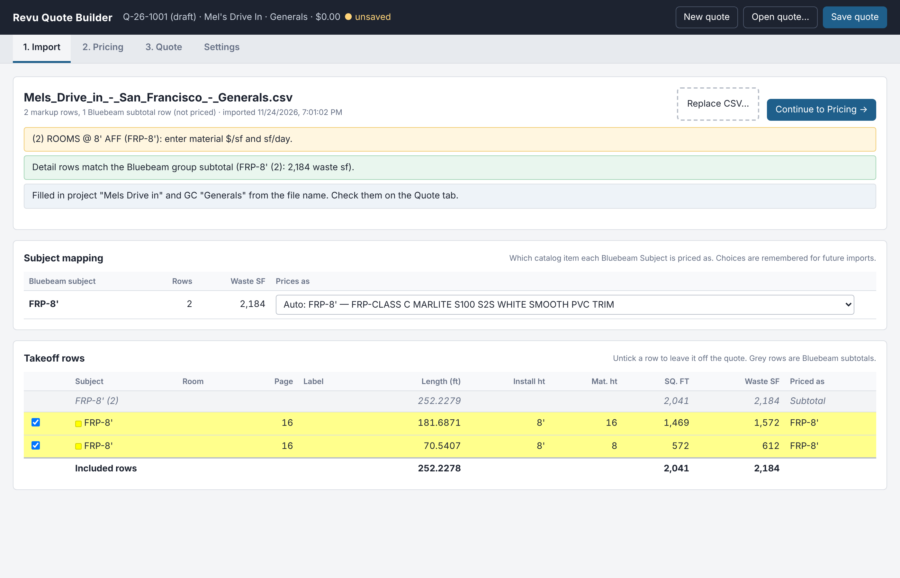
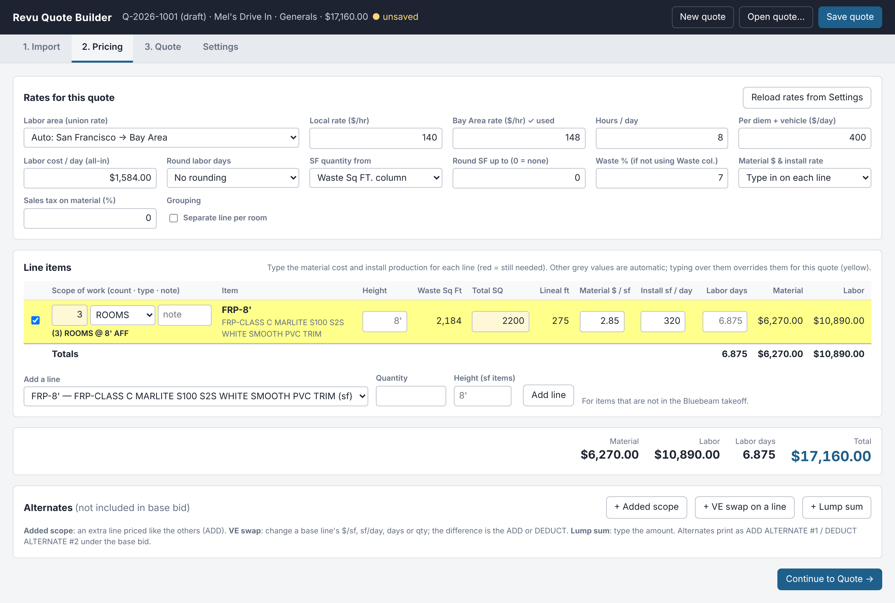
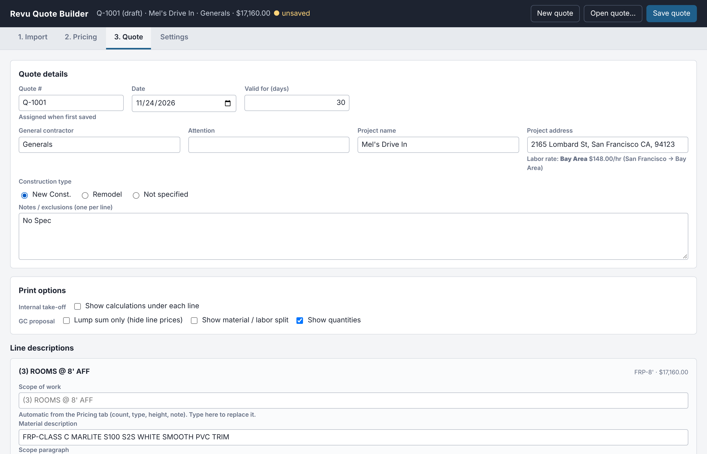
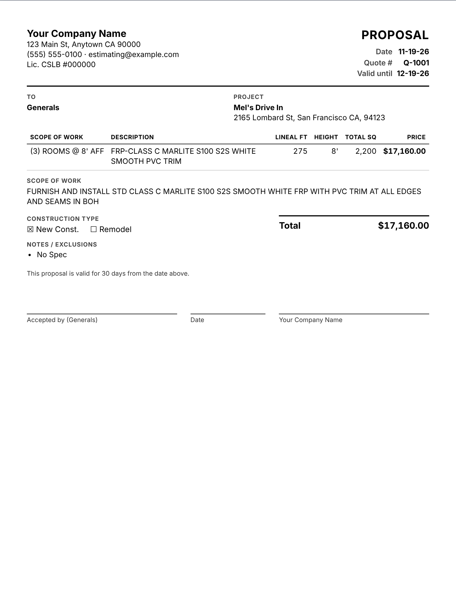
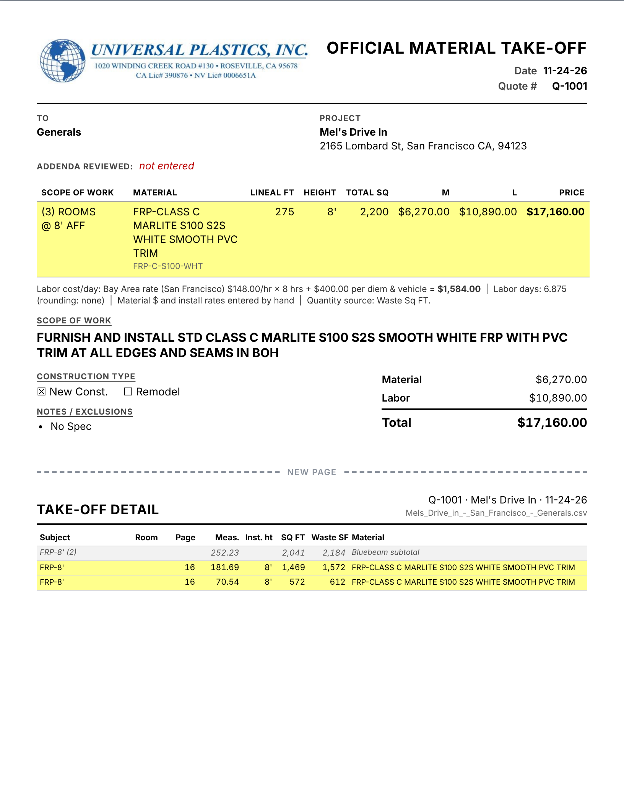
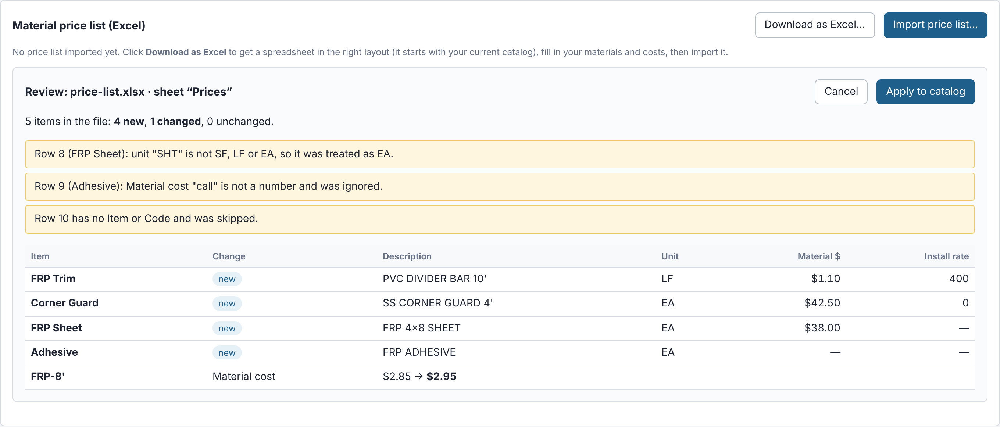

# Revu Quote Builder

A local, offline browser app that turns a **Bluebeam Revu Markups Summary CSV** into a priced
**FRP / wall-panel quote** for general contractors. It replaces the current hand-filled Excel
"Official Material Take-Off" sheet.

---

## 1. Hard constraints

| Constraint | What it means for the code |
|---|---|
| No compilers, build tools, Node, Python, or scripting engines on the user's machine | Plain HTML + CSS + vanilla JavaScript only. No bundler, no TypeScript, no npm at runtime. |
| Runs from a local folder (`file://`) | **No ES modules** (`import` / `type="module"`): Chrome blocks them on `file://`. Use classic `<script src>` tags. **No `fetch()` of local files**: also blocked. Load data with `<input type="file">` / drag-drop, or ship it as `.js` files that assign globals (`window.DEFAULT_CATALOG = {...}`). |
| Must work offline | All third-party libraries are vendored into `/lib`. No CDNs. |
| Target browsers | Current Chrome and Edge on Windows. |

To run it, double-click `index.html`. To run the tests, double-click `test/tests.html`.

### Quick start

1. **Settings** tab: the Universal Plastics letterhead and company details are filled in by default. Add a phone/email if wanted. Check the catalog and labor rates. Click **Export settings** to keep a backup.
2. **Import** tab: drop the Bluebeam Markups Summary CSV. Check the subtotal check and the subject mapping.
3. **Pricing** tab: for each line, fill in the scope of work (**count**, **type** such as ROOMS / AREAS / SOFFITS, and an optional **note** such as "o/ CMU"), then the **material $/sf** and the **install sf/day**. These build labels like "(3) ROOMS @ 8' AFF" or "(7) AREAS @ 10' AFF o/ CMU". The **Local / Bay Area** union rate is picked from the project address (Quote tab). Check it under *Labor area*. Set **Per diem + vehicle** to 0 on local jobs. These start blank, and red fields still need a value.
   - **Total SQ** starts as the Waste Sq Ft from Bluebeam, shown alongside for checking. Type your own number in Total SQ; a value below the takeoff gets a **red border**.
   - **Labor days** can be typed directly for jobs priced by days.
   - Any other rate or quantity can be adjusted for this quote only; changed fields turn yellow.
4. **Quote** tab: fill in the GC, project, construction type and notes. Then use **Print proposal** or **Print internal**, and choose **Save as PDF**.
5. **Save quote** (or Ctrl+S) writes a `.json` file. **Open quote…** re-opens it with its original rates.

You can also drop a `.csv` (import) or `.json` (saved quote or settings export) anywhere on the window.

### Screenshots

These use the Mel's Drive In sample takeoff (`test/fixtures/mels-drive-in.csv`) and the Universal Plastics letterhead.

**1. Import:** the Bluebeam CSV is parsed, checked against its subtotal row, and each subject is mapped to a catalog item.



**2. Pricing:** scope of work (count, type, note), material $/sf and install sf/day are typed in per line. Labor comes from sf ÷ sf/day × $1,584/day.



**3. Quote:** GC, project, construction type, notes and line descriptions.



**4. Print layouts:** the GC proposal (left) and the internal take-off (right), which shows the material/labor split and rates. The take-off detail follows on its own page.

<table>
  <tr>
    <td width="50%"></td>
    <td width="50%"></td>
  </tr>
</table>

**5. Material price list:** importing an Excel price list shows every change for review before it is applied.



---

## 2. Repo layout

```
revu-quote-builder/
├── index.html              # app shell, loads scripts in order
├── css/
│   ├── app.css             # screen styles
│   └── print.css           # quote layout for Print → Save as PDF
├── js/
│   ├── parse.js            # CSV → normalized takeoff rows
│   ├── units.js            # feet-inch / number / unit parsing
│   ├── pricing.js          # takeoff → priced line items
│   ├── quote.js            # quote model, numbering, rendering
│   ├── storage.js          # localStorage + JSON import/export (window.RqbStorage)
│   ├── xlsx.js             # minimal .xlsx reader/writer (no library; uses the browser's DecompressionStream)
│   ├── pricelist.js        # Excel/CSV material price list -> catalog
│   └── app.js              # UI wiring
├── data/
│   └── defaults.js         # window.DEFAULTS = { catalog, rates, company, terms }
├── lib/
│   ├── papaparse.min.js    # vendored CSV parser v5.4.1 (MIT)
│   └── papaparse.LICENSE
├── img/
│   └── universal-plastics-logo.png  # default letterhead on quotes
├── docs/
│   └── screenshots/        # README images
├── test/
│   ├── tests.html          # open in browser; runs plain-JS assertions
│   └── fixtures/
│       ├── price-list.js     # an Excel-written price list (.xlsx, base64) for the reader tests
│       ├── vons-1754.csv / .js # real Bluebeam export for golden test 3
│       ├── mels-drive-in.csv
│       └── mels-drive-in.js  # same CSV as a JS string; tests.html can't fetch() files on file://
└── README.md
```

Load order in `index.html`: `lib/papaparse` → `data/defaults` → `units` → `parse` → `pricing` → `quote` → `storage` → `xlsx` → `pricelist` → `app`.
Each file adds one namespace to `window`: `Units`, `Parse`, `Pricing`, `Quote`, `RqbStorage`, `Xlsx`, `PriceList` and `App`.
Storage uses `RqbStorage` because `window.Storage` is a built-in browser class.

---

## 3. Input: Bluebeam Markups Summary CSV

### 3.1 Sample (fixture: `test/fixtures/mels-drive-in.csv`)

```csv
Subject,Room,Color,Space,Page Index,Measurement,Measurement Unit,SQ. FT,Mat. Height,Install Height,Waste Sq FT.
FRP-8' (2),,,,,252.2279,"ft' in""","2,041",,,"2,184"
FRP-8',,#FFFF00,,16,181.6871,"ft' in""","1,469",16,8',"1,572"
FRP-8',,#FFFF00,,16,70.5407,"ft' in""",572,8,8',612

```

### 3.2 Columns

| Column | Meaning | Parsing notes |
|---|---|---|
| `Subject` | Markup tool name; this is the **mapping key** to the catalog | Group rows look like `FRP-8' (2)` (see 3.3) |
| `Room`, `Space` | Location (often blank) | Optional grouping |
| `Color` | Markup color | Ignore, or use for display only |
| `Page Index` | Drawing page | **Blank = group subtotal row** |
| `Measurement` | Length, in **decimal feet** | Plain float |
| `Measurement Unit` | e.g. `ft' in"` | Contains embedded quotes; PapaParse handles these |
| `SQ. FT` | Bluebeam custom column (wall sq ft) | Has thousands separators: `"2,041"` |
| `Mat. Height` | Bluebeam custom column | Meaning still to confirm (see §9) |
| `Install Height` | Wall height, e.g. `8'` | Feet-inch string → number |
| `Waste Sq FT.` | SQ FT with waste applied (≈ ×1.07) | Thousands separators. **This is the quantity that gets priced.** |

### 3.3 Parsing rules

1. Parse with PapaParse: `{ header: true, skipEmptyLines: 'greedy' }`.
2. Trim header names. Match columns by normalized name (lowercase, strip punctuation), not by position, because column order can change between export profiles.
3. **Drop group subtotal rows**: `Page Index` is blank **and** `Subject` matches `/\(\d+\)$/`. Keep them only to cross-check that the detail rows sum to the subtotal; show a warning if they don't.
4. Numbers: strip `,` before `parseFloat`. Blank → `null`, never `0`.
5. Feet-inch strings (`8'`, `8'-6"`, `8' 6"`, `6"`, `8.5`) → decimal feet in `Units.parseFeet()`.
6. Strip the base subject (`FRP-8' (2)` → `FRP-8'`) for catalog lookup.
7. The UTF-8 BOM that Revu writes is stripped. Any title lines above the header row are skipped: the header is the first row that has a `Subject` column.

**Expected result for the fixture:** 2 detail rows. Total Waste Sq Ft = 1,572 + 612 = **2,184**, which matches the subtotal row.

---

## 4. Pricing model

This is reverse-engineered from the current Excel template (`Template` sheet, rows 8–15).

### 4.1 Per line item

| Field | Excel source | Formula |
|---|---|---|
| Total SQ (priced) | `L9` = 2200 (typed in by hand) | `sum(Waste Sq Ft)` by default; typed in per line when the estimator wants a different number (see below) |
| Height | `K9` = 8 | Install Height |
| Lineal Ft | `J9 = ROUNDUP(L9/K9, 0)` | `ceil(totalSq / height)` |
| **Material (M)** | `H9 = L9 * 2.85` | `totalSq × materialRatePerSf` |
| **Labor (L)** | `H10 = L9 / 320 * A11` | `(totalSq / sfPerDay) × dayRate` |
| Day rate | `A11 = 148*8 + 400` | `union hourly rate × hoursPerDay + dailyAdder`. The hourly rate is **Local** or **Bay Area** depending on the project city (see "Union rates" below). This is the all-in labor cost per crew-day: `dailyAdder` covers per diem and vehicle use. In Excel it can sit in any cell; the app computes it from Settings. |
| **Line total** | `D15 = SUM(H9:I12)` | `M + L` |

Labor days are **not** rounded in the current sheet (6.875 days). Make rounding a setting: `none | half | whole`, default `none` to match the current numbers.

**Implementation notes**

- **Line grouping:** takeoff rows are grouped into one line per *Bluebeam subject × install height*.
  - Two subjects priced as the same catalog item stay separate lines, so they can have different production rates. Example: `FRP-10'` and `FRP-10' CMU` are the same material, but CMU walls install slower.
  - A different height also gives a separate line, because Lineal Ft = SQ ÷ height needs a single height.
  - The optional "Separate line per room" setting also splits lines by room.
  - Quotes saved before this change keyed their line overrides by catalog item; those are still picked up.
- **Quantity source** (`quantity.source`):
  - `wasteSqFt` (default) uses the Waste Sq FT. column.
  - `sqFt` uses SQ. FT × (1 + `wastePct`).
  - `calc` uses Measurement × Install Height × (1 + waste).
  - If the chosen column is blank on a row, the next option is used and a note is shown.
- **Units come from the CSV first:**
  - **Count** in *Measurement Unit* (the Bluebeam Count tool) → the row is **EA**. Quantity = the counted number, e.g. 5 + 3 = 8, not the number of markups.
  - **LF** in *Install Height* → the row is **LF**. Quantity = Measurement (feet), used as measured.
  - Otherwise the catalog item's unit applies (`sf` normally). `sf` quantities come from the Waste Sq FT. column as above.
  - This holds even when the subject is mapped to a square-foot catalog item. The line becomes EA/LF and that item's $/sf and sf/day are **not** reused, so they must be typed in.
  - A subject with both wall and LF/EA rows splits into separate lines (walls first).
  - EA lines get the scope label "(8) EA". LF/EA lines have no height or "AFF". **New catalog item…** on the Import tab picks EA/LF for such subjects.
  - Catalog `ea` items without Count markups count 1 per markup.
- **Manual rate entry (`rateEntry: "manual"`, the default):** material $ per unit and install units per day are typed in on each line of each quote. This stays until material costs can come from a database.
  - Until both values are entered, the line is flagged and the total is understated.
  - The Pricing tab shows red fields and an "incomplete" badge, the Quote tab shows a warning, printing asks for confirmation, and the internal take-off prints an INCOMPLETE banner.
  - Entering `0` for units/day means material only, with no labor.
  - Set `rateEntry` to `"catalog"` (Settings → Labor & quantities, or per quote on the Pricing tab) to pre-fill both values from the catalog instead.
  - Quotes saved before this option existed open in catalog mode, so their totals don't change.
- **Total SQ:** starts as the sum of the Waste Sq FT. column, with **no rounding**.
  - The Pricing tab shows that original basis (**Waste Sq Ft**) next to the editable **Total SQ**, so a typed number can be checked against what Bluebeam measured.
  - A Total SQ typed **below** the takeoff gets a red border and a warning. It is still allowed, but is likely a typo. The internal take-off marks it "BELOW TAKEOFF"; the GC proposal never shows this.
  - "Round SF up to" still exists as an option (0 = none). Settings saved while 100 was the default are upgraded to 0.
- **Union rates (Local vs Bay Area):**
  - Two hourly rates are kept: **Local $140/hr** and **Bay Area $148/hr** (2026). Update both each year in Settings.
  - The project city is read from the project address. For example, "2165 Lombard St, San Francisco CA, 94123" gives San Francisco, and a city in **Settings → Union wage areas** gets the Bay Area rate; every other city (or no address) gets Local.
  - The city list starts as the cities of the nine Bay Area counties. Edit it to match the union's wage areas.
  - On the Pricing tab, *Labor area* shows what was picked ("Auto: San Francisco → Bay Area") and can be forced to Local or Bay Area for one quote. The rate in use is marked "✓ used". The Quote tab shows it under the project address.
  - Hours/day and per diem + vehicle are separate settings that don't depend on the area.
  - An area whose rate is blank flags the quote as incomplete.
  - Quotes saved before this change keep the one rate they were priced with. Saved settings holding the old single $148 default become $140 Local / $148 Bay Area; a rate someone set themselves is kept as Local.
- **Markup colours:** each row is shaded with its Bluebeam markup colour from the `Color` column (e.g. `#FFFF00`), lightened so text stays readable (yellow → light yellow).
  - This applies to takeoff rows on the Import tab, line items on the Pricing tab (the most common colour among the line's markups), and the internal take-off.
  - The GC proposal is never shaded. Rows without a colour stay white.
- **Labor by days:** a line's Labor days can be typed instead of being calculated from sf/day. Example: the Vons custom Symmetrix line is 9 days × the day rate. Clearing it goes back to sf/day.
- **Per-quote overrides:** each quote stores a snapshot of the catalog, labor and quantity settings. Any line can override its Total SQ, height, $/unit, units/day or labor days. Blank means automatic.
- **Scope of work label:** built as `(count) TYPE @ height' AFF note`, matching the Excel sheets: `(3) ROOMS @ 8' AFF`, `(6) AREAS @ 10' AFF`, `(7) AREAS @ 10' AFF o/ CMU`, `(4) SOFFITS @ 2'`.
  - On the Pricing tab each line has a **count**, a **type** (ROOMS, AREAS, WALLS, COLUMNS, SOFFITS, CEILINGS) and an optional **note**.
  - SOFFITS and CEILINGS give a depth rather than a height above the floor, so they omit "AFF". A count of 1 uses the singular, e.g. "(1) ROOM".
  - **Count:** defaults to Bluebeam's group count, e.g. `104-FRP-10' (2)` → 2 and `126-MARLITE-4' (15)` → 15. Type over it when the real number differs (Vons: 15 markups, but "(4) ROOMS").
    - If some of the subject's markups are unticked, or the subject is split across lines (two heights, or per-room lines), the default is the number of markups on that line instead.
    - Manual lines have no default and are flagged until a count is entered.
    - Room/Space names are not used for the count, since one Room ("SALES") can hold many rooms. Hovering over the count box shows them as a hint.
  - **Guesses from the Bluebeam subject:** a subject containing "SOFFIT" starts as SOFFITS (similarly CEILING, COLUMN), and one containing "CMU" gets the note "o/ CMU". Both can be changed.
  - The height comes from the line's install height.
  - The whole label can be typed by hand on the Quote tab (Line descriptions). Clearing it brings back the automatic label.
  - On printouts the label only wraps between its parts, never inside "@ 10' AFF".
- **Manual lines** can be added for items that aren't in the takeoff. They are priced at the quantity typed, with no rounding.
- **Sales tax:** an optional % on material (`terms.taxPct`, default 0). The tax line is only shown when it is non-zero.
- Money is rounded to the cent per line. Totals are the sum of the line totals.

### 4.2 Default rates (`data/defaults.js`)

```js
window.DEFAULTS = {
  catalog: [
    {
      subject: "FRP-8'",
      code: "FRP-C-S100-WHT",
      description: "FRP-CLASS C MARLITE S100 S2S WHITE SMOOTH PVC TRIM",
      scope: "FURNISH AND INSTALL STD CLASS C MARLITE S100 S2S SMOOTH WHITE FRP WITH PVC TRIM AT ALL EDGES AND SEAMS IN BOH",
      unit: "sf",            // "sf" | "lf" | "ea"
      materialRate: 2.85,    // $ per unit   (old name materialRatePerSf is still accepted)
      unitsPerDay: 320       // per crew-day (old name sfPerDay is still accepted); 0 = no labor
      // roundTo: 100        // optional per-item quantity rounding
    }
  ],
  subjectMap: {},            // remembered Bluebeam Subject -> catalog subject ("__ignore__" = leave off)
  labor: { hourlyRate: 140, bayAreaHourlyRate: 148, hoursPerDay: 8, dailyAdder: 400, dayRounding: "none" },  // Local / Bay Area $/hr
  bayAreaCities: ["Alameda", "Albany", /* … nine Bay Area counties … */ "Windsor"],
  quantity: { source: "wasteSqFt", roundTo: 0, wastePct: 7 },   // 0 = Total SQ is the Waste Sq FT. sum as-is
  rateEntry: "manual",       // "manual" = type material $ and sf/day per quote | "catalog" = pre-fill from catalog
  company: { name: "", address: "", phone: "", email: "", license: "", logoDataUrl: "" },
  terms: { validDays: 30, notes: ["No Spec"], taxPct: 0 },
  proposal: { showSplit: false, lumpSum: false, showUnitQty: true },
  quote: { nextNumber: 1001, prefix: "Q-" }
};
```

### 4.3 Golden test (must match the Excel sheet to the penny)

| | Value |
|---|---|
| Waste Sq Ft (sum) | 2,184 |
| Total SQ (typed in; the takeoff basis is 2,184) | 2,200 |
| Lineal Ft | 275 |
| Material | 2,200 × 2.85 = **$6,270.00** |
| Day rate | 148 × 8 + 400 = $1,584.00 |
| Labor | 2,200 / 320 × 1,584 = **$10,890.00** |
| **Total** | **$17,160.00** |

**Golden test 2: Roseville Aquatics Complex - Alteration** (three lines of the same material, from a second in-house estimate)

| Scope of work | Total SQ | Lineal Ft | Material @ $13.65 | sf/day | Labor @ $1,184/day |
|---|---|---|---|---|---|
| (6) AREAS @ 10' AFF | 1,260 | 126 | $17,199.00 | 220 | $6,781.09 |
| (7) AREAS @ 10' AFF o/ CMU | 2,465 | 247 | $33,647.25 | 200 | $14,592.80 |
| (4) SOFFITS @ 2' | 128 | 64 | $1,747.20 | 80 | $1,894.40 |
| **Total** | | | | | **$75,861.74** |

This estimate used a $1,184 day rate ($148 × 8, with the per diem + vehicle amount set to 0) and did not round Total SQ to 100. Both are per-quote settings on the Pricing tab.

The $148/hr on this sheet was a mistake: Roseville is a **Local** job at **$140/hr**. The test reproduces the sheet's arithmetic above to check the formulas, then checks the corrected price at $1,120/day: labor $6,414.55 / $13,804.00 / $1,792.00, **total $74,604.00**. The app prices Roseville at $140/hr by default.

**Golden test 3: Vons #1754, Fresno** (the real Bluebeam export is `test/fixtures/vons-1754.csv`)

| Scope of work | Waste Sq Ft → Total SQ | Lineal Ft | Material | Labor @ $1,660/day |
|---|---|---|---|---|
| (2) ROOMS @ 10' AFF | 1,351 → 1,500 | 150 | 1,500 × $3.60 = $5,400.00 | 1,500 ÷ 180 sf/day = $13,833.33 |
| (4) ROOMS @ 4' AFF | 2,978 → 3,300 | 825 | labor only ($0) | 3,300 ÷ 150 sf/day = $36,520.00 |
| (9) CUSTOM SYMMETRIX SIGN @ 6' | 1,576 → 1,580 | 198 (height 8) | labor only ($0) | 9 days entered = $14,940.00 |
| **Total** | | | | **$70,693.33** |

- The day rate is $140 × 9 hrs + $400 = $1,660.
- The Symmetrix scope label is typed by hand, and its height is set to 8 (the Mat. Height), so lineal ft = 1,580 ÷ 8.

---

### 4.4 Material price list (Excel)

Material costs are kept in an Excel workbook, expected to hold around 150 items, and imported into the catalog from **Settings → Material price list**. Dropping an `.xlsx` file on the window does the same thing.

- **Download as Excel** writes `Material Price List.xlsx` in the expected layout, filled with the current catalog. It has a "How to use" sheet. This is the easiest way to start the spreadsheet.
- **Import price list** reads `.xlsx` or `.csv`:
  - Columns are matched by header name, in any order. Title rows above the header and extra columns are ignored, and the first sheet with a recognisable header row is used.
  - Columns: **Item** (required, or **Code**), Code, Description, Unit (SF/LF/EA), **Material Cost** ($/unit), **Install Rate** (units/day), Scope, Round To. Common alternative names such as "Price", "Unit Cost", "SF/Day" and "SKU" are also recognised.
  - Rows match catalog items by Item name (case-insensitive), then by Code. A changed name never renames a catalog item, so Bluebeam mappings keep working.
  - **Blank cells never erase existing values.** Catalog items missing from the sheet are kept.
- A review screen lists new items, changed fields (old → new) and warnings (unknown unit, non-numeric cost, rows without an item). Nothing is applied until you confirm.
- To have new quotes use these prices, set *Material $ & install rate* to **Pre-fill from catalog**. The card offers a button for this after an import.
  - In that mode, an item with a blank cost or install rate in the price list still has to be typed in on the quote. This lets the sheet hold material costs while sf/day stays a per-job entry.
- Open quotes keep the rates they were created with. **Pricing → Reload rates from Settings** applies a new price list to the open quote. The internal take-off shows which price list file was used, and when it was imported.
- `.xls` (Excel 97–2003) files are not read; re-save them as `.xlsx`. The reader needs Chrome or Edge 103 or later, for `DecompressionStream('deflate-raw')`.

## 5. Quote document

Header and fields mirror the current sheet:

- **Header:** company letterhead or logo + name, title ("OFFICIAL MATERIAL TAKE-OFF" internally / "PROPOSAL" for the GC), date (today, `mm-dd-yy`), quote number
- **To:** General contractor name
- **Project:** name (e.g. *Mel's Drive In*) + address (e.g. *2165 Lombard St, San Francisco CA, 94123*)
- **Line items** (up to ~15, same as the template's row blocks):
  Scope of work (e.g. `(3) ROOMS @ 8' AFF`) · Material description · Lineal Ft · Height · Total SQ · Price
- **Scope of work** (one text box on the Quote tab, above Notes / exclusions). It starts as the catalog `scope` of each line item (each paragraph once) and can be edited freely; *Use automatic text* restores it. On both printouts it is printed in 12pt bold, the same as the Total line.
- **Section headings** SCOPE OF WORK, CONSTRUCTION TYPE and NOTES / EXCLUSIONS are underlined on both printouts.
- **Construction type:** ☐ New Const. ☐ Remodel
- **Notes / exclusions** (e.g. "No Spec")
- **Grand total**

Two print views from the same data:
1. **Internal take-off**:
   - **Page 1:** the M/L split, rates and labor-days summary (the labor cost/day line under the line items), with no per-line calculation rows by default. Turn those on with *Quote tab → Print options → Show calculations under each line* (default in Settings). A Total SQ typed below the takeoff is still flagged on its line.
   - **Take-off detail:** always starts on its own page and runs onto more pages if needed, with the column headings repeated. Each Bluebeam row shows the material description it is priced as, shaded with its markup colour; the Bluebeam subtotal rows stay in CSV order.
2. **GC proposal**: shows only line descriptions, quantities, and price (or lump sum). Hides the rates.

Output = `print.css` + `window.print()` → user picks "Save as PDF". No PDF library needed.

---

**Company letterhead.**
- The default logo is `img/universal-plastics-logo.png`, the full Universal Plastics letterhead with name, address and CA/NV licenses. It prints as a banner in the header, with no duplicate text block; phone/email, if entered, print under it.
- The company name is also used on the proposal's signature line.
- To use a different image: Settings → Company → Replace logo, or replace the file.
  - Wide images (3:1 or wider) are treated as a letterhead. Others print as a small logo beside the company details.
  - **Logo style** switches between the two.
- Browsers that had no company details saved get the letterhead automatically (settings `version: 3`). Details someone entered are kept.

**Alternates** (Pricing tab → Alternates). These are options for the GC that are **not included in the base bid**:
- **Added scope:** an extra line priced like the others: catalog item, qty, height, $/unit, units/day (or labor days). It is always an ADD.
  - Example: 400 sf at $2.85 / 320 sf/day = ADD $3,120.00.
- **VE swap:** pick a base line and change only what differs (qty, $/unit, units/day or labor days). The difference from the base line is the ADD or DEDUCT.
  - Example: $2.85 → $2.00/sf on 2,200 sf = DEDUCT ($1,870.00).
- **Lump sum:** type ADD or DEDUCT and an amount.

On the GC proposal the total becomes **Base bid**, followed by an underlined **ALTERNATES (not included in base bid)** section: `ADD ALTERNATE #1 … ADD $3,120.00`, `DEDUCT ALTERNATE #2 … DEDUCT ($1,870.00)`, numbered in one running sequence.
- The internal take-off adds each alternate's material/labor difference and what was changed.
- Incomplete alternates are flagged, and printing asks for confirmation.
- Sales tax, if set, applies to an alternate's material difference.
- Alternates are saved with the quote.

## 6. Screens

1. **Import:** drag-drop a CSV, then show the parsed table with subtotal rows greyed out, warnings (unmapped subject, subtotal mismatch, blank quantity), and a mapping dropdown for any unmapped Subject (remembered in settings).
2. **Pricing:** one editable row per catalog item, with every rate overridable per quote and live totals.
3. **Quote:** GC / project / address / construction type / notes, then a preview with "Print Internal" and "Print Proposal" buttons.
4. **Settings:** catalog editor, labor rates, rounding, company info + logo upload (stored as a data URL), terms, next quote number.

---

## 7. Persistence

- Settings live in `localStorage` under the key `rqb.settings.v1`, seeded from `DEFAULTS` on first run.
- The quote in progress is autosaved to `rqb.draft.v1`, so it survives a closed tab. That autosave is not a backup; use **Save quote**.
- **Export / Import Settings** buttons save and load a `.json` file. That file is the real backup, because browser storage can be cleared.
- **Save Quote / Open Quote** handles a `.json` file holding the quote, its source CSV rows, and the rates used, so an old quote re-opens with its original numbers. Use `showSaveFilePicker` when available; otherwise fall back to a Blob download.
- A new quote shows the next number marked "(draft)". The number is taken, and `nextNumber` incremented, on the quote's **first** save; later saves keep it. Typing a number by hand fixes it.

---

## 8. Milestones

All six milestones are implemented. `test/tests.html` covers milestones 1 and 2, plus the overrides, LF/EA items, numbering, save/open round-trip and rendering.

1. **Parse:** `units.js` + `parse.js`; `tests.html` passes on the fixture (2 rows, 2,184 sf).
2. **Price:** `pricing.js`; the golden test in §4.3 passes.
3. **UI:** import → pricing → quote screens, using the default settings.
4. **Print:** internal + proposal print layouts.
5. **Settings + persistence:** catalog editor, JSON import/export, quote save/open.
6. **Polish:** multiple subjects / multiple catalog items per quote, room grouping, logo.

---

## 9. Open questions

- [x] **Rounding:** no automatic rounding. Total SQ defaults to the Waste Sq FT. basis and is typed in per line, with the original shown alongside. Values below the takeoff are flagged in red.
- [ ] **`SQ. FT` vs length × height:** the Bluebeam values don't exactly equal Measurement × 8 (181.69 × 8 = 1,453.5, but the CSV says 1,469). What formula does the Revu custom column use? Should the app trust it or recompute it?
- [ ] **`Mat. Height`** (16 and 8 in the sample): is this panel sheet height, and does it affect pricing?
- [x] **Day rate:** $1,584/day is the all-in labor cost per crew-day: $148/hr × 8 hrs plus $400 for per diem and vehicle use. The UI labels the $400 "Per diem + vehicle". It varies by job: Roseville used $1,184 (no per diem/vehicle). Set it per quote on the Pricing tab.
- [x] **Union rates:** Local $140/hr, Bay Area $148/hr (2026), picked from the project city. The Roseville sheet's $148/hr was a mistake; Local $140/hr is correct.
- [x] **Material $ and sf/day:** entered by hand on each quote for now. Material costs will come from an Excel price list (~150 items); the import is built (§4.4). Next step: build the real price list and switch to "Pre-fill from catalog".
- [ ] **Labor production:** is 320 sf/day still the usual figure? Is the day rate the same on every job? (It can be changed per quote on the Pricing tab.)
- [ ] **GC proposal:** show the material/labor split, or a lump sum only? Is tax included or excluded?
- [ ] Other products besides FRP (other subjects, other units such as LF trim or EA corners)?
- [ ] Standard exclusions / terms text to include on every proposal.
